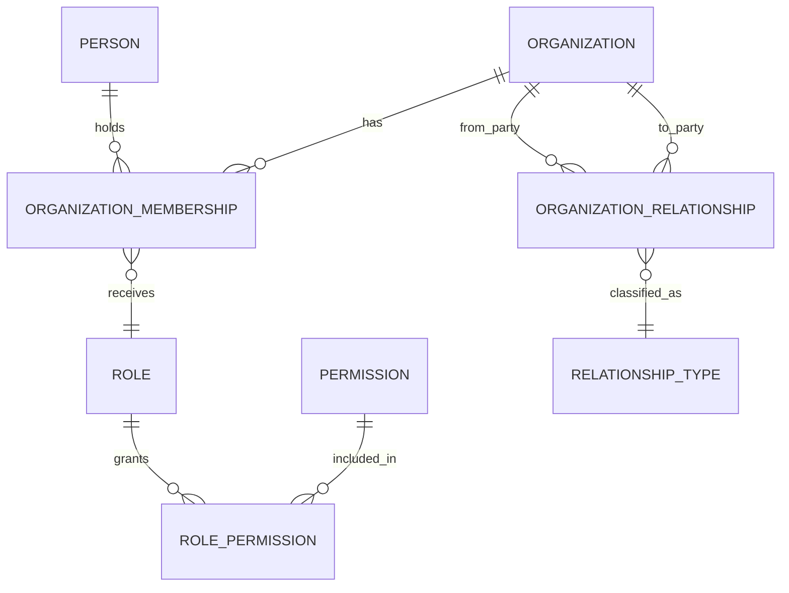

# Identity, Organization, and Relationship Model

## Status and purpose

Version 1.1.0 records the approved conceptual architecture decisions. It does not
approve production database changes or deployment. Session organization
context was separately implemented in migration `0029`. A narrow identity and
organization-scope hardening implementation, including local migration `0031`,
is now present in the uncommitted working tree for review; it has not been
applied to production. The broader person/role reference and pairwise
relationship redesign remains review-only.

The purpose is to establish a safe extension path for the existing SMRITISYS
identity and partner model. The intended boundary is the one in
[ARCHITECTURE.md](../../ARCHITECTURE.md): SMRITISYS is the shared control plane;
Retail OS and other operational products remain separate applications.

## Approved architectural decisions

1. Keep `organizations` as the canonical business-entity record.
2. Use `organization_members` as the canonical membership for customer,
   partner, and internal organization access. One person may have multiple
   independent memberships.
3. Keep `partner_memberships` only as a transition adapter or for partner-only
   metadata. It must not remain a second authorization source.
4. Require explicit organization-context selection when a person has multiple
   memberships. Never silently select the first membership.
5. Keep an organization's program classification separate from a pairwise
   relationship between two organizations.
6. Treat existing `partner_customer_links` as access assignments, not sales
   attribution. Represent a customer once, even when multiple partners have
   different roles with that customer.
7. Use one effective role per membership. A role grants actions; an active
   organization relationship scopes customer records. Neither a partner
   category nor a relationship type grants permissions by itself.
8. Do not merge people or organizations automatically based on matching email
   addresses or names.
9. Retain the existing six partner categories. Their business meanings remain
   distinct from member roles and organization-relationship types.
10. Represent employees through membership in the SMRITISYS organization.
    Super-admin access is a separate, explicit system-wide permission.
11. Keep existing APIs and tables compatible during staged migration. Do not
    add `/api/v1` or remove current routes as part of this identity migration.
12. Keep product-license entitlements separate from user authorization
    permissions.

## Scope and non-goals

In scope:

- Person/account mapping and organization membership.
- Membership roles and permission evaluation.
- Organization classification versus organization-to-organization relationships.
- Partner access to assigned customer organizations.
- Session organization context for multi-membership users.
- Existing-table mapping, migration phases, and acceptance criteria.

Not in scope:

- Implementing a partner category policy or deciding commercial responsibilities.
- Deal registration, quote/price-book, commission, payout, or accounting schemas.
- Retail OS operational records or APIs.
- A production migration, code refactor, deployment, or framework change.
- A cross-account person-merge workflow. That requires an explicit identity
  verification and recovery policy.

## Current repository model

| Existing record | Current purpose and limitation |
|---|---|
| `users`, `customers` | Separate credential/account tables. An account is identified at runtime by `account_type` and `account_id`. |
| `people` | One row per `(source_type, source_id)` account pair. This is a useful identity projection, but matching emails do not currently prove two account rows belong to one human. |
| `organizations` | Canonical organization table with profile, tax, location, and status fields. |
| `organization_members` | Associates an organization with an account using polymorphic `account_type`/`account_id`; `member_role` is a role-name string. |
| `roles`, `permissions`, `role_permissions` | Existing role/permission catalog. Authorization resolves role names through this catalog. |
| `relationships` | Organization-level classification such as `customer`, `internal`, or a partner type. It has no second organization endpoint and must not be mistaken for a pairwise business relationship. |
| `partner_memberships` | A second membership-like record with partner organization, account, partner role, partner type, and status. Role and type data overlap other tables. |
| `partner_customer_links` | A direct partner-to-customer assignment with status. It currently provides customer scope but does not state whether the partner sourced, resells, implements, or services the customer. |
| `audit_logs` | Existing actor, organization, action, resource, old/new value, IP, and timestamp fields for auditable mutations. |
| `sessions` | Stores account identity and the selected `organization_id` added by migration `0029`. Identity resolution requires that explicit, active membership; it does not fall back to the first membership. In the local working tree, partner authorization uses the selected canonical membership role and an active partner classification; `partner_memberships` is retained as a compatibility projection. Production has not received this local authorization change. |

The identity and partner baseline is implemented in
[schema.sql](../../schema.sql), [0002_identity_rbac.sql](../../migrations/0002_identity_rbac.sql),
[0008_partner_relationships.sql](../../migrations/0008_partner_relationships.sql),
[0025_customer_partner_administration.sql](../../migrations/0025_customer_partner_administration.sql),
and [0029_session_organization_context.sql](../../migrations/0029_session_organization_context.sql).
Partner-specific inventory permissions were added in
[0026_partner_sales_governance.sql](../../migrations/0026_partner_sales_governance.sql).
Partner deal registration was added in
[0030_partner_workflow_foundations.sql](../../migrations/0030_partner_workflow_foundations.sql).
The runtime session and permission logic is in the
[API handler](<../../functions/api/[[path]].js>).

The six partner classifications currently used by the repository are
`channel_partner`, `reseller`, `implementation_partner`, `technology_partner`,
`referral_partner`, and `distributor`. This proposal does not rename or expand
that set. Whether labels such as VAR, MSP, or SI map to one or more classifications
is a business-policy decision, not a database inference.

## Read-only production verification — 2026-11-22

The production D1 database was inspected with Wrangler 4.162.0 using remote
migration metadata and aggregate-only SQL queries. The checks reported zero
rows written, `changed_db: false`, no pending migrations, and no
`PRAGMA foreign_key_check` violations. No production schema or data was changed.

### Migration and identity state

- The latest applied migration records are `0028_customer_profile_management.sql`,
  `0029_session_organization_context.sql`, and
  `0030_partner_workflow_foundations.sql`.
- There are 1 user, 1 customer account, 2 people, 3 organizations, 2
  organization memberships, and 3 active organization classifications.
- Active classifications include one `channel_partner`, one `customer`, and
  one `internal` organization.
- There are no active multi-membership accounts, no partner memberships, and
  no partner account records. There is one active partner-customer assignment
  and one pending partner invitation. These existing records were not changed.
- Read-only checks found zero memberships without a matching person, zero
  memberships with an invalid role, zero partner memberships without a person,
  and zero partner-customer assignments with a missing organization.
- There is one active `admin.system` grant. The API guard also requires the
  internal `user` account type and `super_admin` member role.

### Session-context verification

The production API's organization-context GET returns active memberships and
the selected session organization. Its POST accepts only an active membership,
updates that session, and writes an audit record. `getIdentitySession` requires
a non-null selected organization and joins it to the caller's active
organization membership. In the production runtime inspected on 2026-11-22,
the partner resolver also reads `partner_memberships`; the local working tree
instead uses the canonical membership role and active partner classification.
Both versions scope partner customer, license, and release queries by the
selected partner organization and active customer assignments.

There are eight unexpired production sessions: one has an organization context
and seven do not. A session without a selected organization cannot pass
`getIdentitySession`; the context-selection flow must be completed before
organization-scoped APIs work. No session was created, selected, invalidated,
or otherwise modified for this review. A live portal login/context-selection
test was therefore not performed because it would write production session
and audit data.

### Authorization tests and limits

The full local suite passed **120/120**. It includes tests for explicit
organization-context selection, internal admin guards, customer organization
isolation, and partner assigned-customer scoping using synthetic fixtures.
Production contains no partner memberships and no account with multiple active
organization memberships, so live data cannot prove those multi-tenant cases.
The tests do not replace an authorized live portal verification.

## Target logical model



### Person and membership

- `Person` is the authenticated principal used for audit attribution and
  authorization. Existing `people` rows remain linked to legacy login accounts
  during the first migration.
- `OrganizationMembership` connects one person to one organization. It has its
  own status and role; membership in one organization does not imply membership
  or access in another.
- The legacy `users` and `customers` tables remain the credential/account source
  until a separate, approved authentication migration. No credentials are
  copied, merged, or re-keyed by this work.
- A later account-linking feature must require verified control of both accounts
  and preserve an audit trail. Email equality alone is not a safe merge rule.

### Role and permission

- A membership's role is resolved through the existing `roles` table and
  `role_permissions`.
- For the first target version, use one effective role per organization
  membership. Do not add multi-role composition until a concrete use case and
  conflict-resolution rule are approved.
- Partner roles such as `partner_admin` and `partner_member` are membership
  roles, not partner categories.
- Authorization permissions (`license.view`, `support.create`, etc.) are not
  product-license entitlements. Keep those domains separate.

### Organization classification and relationship

- Keep the existing `relationships` concept as organization-level
  classification during this migration. It answers “what kind of organization
  is this?” It does not answer “how is organization A related to organization B?”
- Add a separate, pairwise `organization_relationships` domain for business
  roles between organizations. Its direction is explicit:
  `from_organization_id` is the partner/provider/source organization and
  `to_organization_id` is the customer/recipient organization.
- A customer may have multiple active relationships with different partners,
  including multiple relationships of different types with the same partner.
- Example types to evaluate with the business include `partner_assignment`,
  `sales_source`, `reseller`, `service_provider`, `implementation_provider`,
  `technology_provider`, `referral_source`, and `distributor`. These are
  examples, not an approved taxonomy.
- `partner_assignment` represents the existing access link only. Backfilling an
  old link must not imply sales attribution, revenue ownership, or a service
  commitment.
- A relationship type is descriptive and is not an authorization grant. Access
  still requires an active membership, an appropriate role permission, and an
  active relationship that scopes the target organization.

## Candidate D1 schema changes — not approved for implementation

These are logical schema changes for design review, not migration-ready SQL.
Exact constraints, index names, and backfill statements must be checked against
the production D1 schema and deployed data before implementation.

### 1. Canonical organization membership

Add a nullable `person_id` foreign key to `organization_members`, backfilled from
`people` by the exact `(account_type, account_id)` pair. Add a `role_id` foreign
key to `roles` after validating every existing `member_role` string. Retain the
legacy account and role-name columns during the compatibility period.

After duplicate and orphan checks, enforce one membership per
`(organization_id, person_id)`. Do not merge duplicate memberships automatically:
report them for explicit resolution. Keep `partner_memberships` as a
compatibility record during cutover, then either retire it or retain only
partner-specific metadata keyed by the canonical membership. It must not remain
a second authorization source.

### 2. Explicit organization relationship types

Add:

```text
organization_relationship_types
  code                 TEXT PRIMARY KEY
  label                TEXT NOT NULL
  description          TEXT
  is_active             INTEGER NOT NULL

organization_relationships
  id                    INTEGER PRIMARY KEY
  from_organization_id  INTEGER NOT NULL REFERENCES organizations(id)
  to_organization_id    INTEGER NOT NULL REFERENCES organizations(id)
  relationship_type     TEXT NOT NULL REFERENCES organization_relationship_types(code)
  status                TEXT NOT NULL
  valid_from            TEXT
  valid_to              TEXT
  created_by_person_id  INTEGER REFERENCES people(id)
  created_at            TEXT NOT NULL
  updated_at            TEXT NOT NULL
  CHECK (from_organization_id <> to_organization_id)
```

Required indexes:

- From organization, type, and status.
- To organization, type, and status.
- A partial uniqueness rule preventing duplicate active rows for the same
  `(from_organization_id, to_organization_id, relationship_type)`, while
  allowing ended historical rows.

Use the existing audit writer for creation, approval, suspension, and ending.
Relationship status changes must preserve who changed it and when; do not
hard-delete relationship history.

### 3. Session context

Add a nullable active membership reference to `sessions` after the membership
backfill is complete. Add server endpoints to list the authenticated person's
active memberships and select one. The server validates the selected membership
against the authenticated person on every context change.

Do not silently choose the first membership. During transition, legacy requests
may use an implicit context only when there is exactly one eligible membership;
otherwise return an explicit ambiguity response and require context selection.

### 4. Partner classifications

Keep the current six classifications until business owners approve a mapping or
taxonomy change. Store the partner classification at the organization level,
not redundantly on each partner member. Existing `partner_type` values in
membership and invitation records remain readable during migration but become
deprecated once the canonical classification is validated.

## API authorization rules

Every protected request must:

1. Authenticate the session and resolve the current person.
2. Resolve an active organization membership for the requested context.
3. Resolve the membership's role and required permission server-side.
4. For customer data accessed through a partner, verify an active
   `organization_relationships` row linking the selected partner organization
   to the requested customer organization.
5. Apply the customer organization predicate in the data query itself; do not
   fetch a broad result and rely on browser filtering.
6. Reject inactive people, sessions, memberships, organizations, and
   relationships.
7. Record relationship/role mutations in `audit_logs` with actor, organization,
   resource, and before/after state.

Client-provided organization or membership IDs may select a context, but never
grant it. The server must verify that the authenticated person holds that
membership. Admin/super-admin access remains governed by the existing internal
role and permission checks and must not be inferred from partner or customer
membership.

## Existing-table mapping

| Existing table | Target treatment |
|---|---|
| `users`, `customers` | Retain as legacy credential stores; no credential migration in this specification. |
| `people` | Retain as principal/audit identity. Backfill memberships by exact source account pair. Do not deduplicate on email. |
| `organizations` | Retain as the canonical organization master and preserve IDs. |
| `organization_members` | Evolve into the canonical membership table; add `person_id` and validated role reference, retaining legacy fields temporarily. |
| `roles`, `permissions`, `role_permissions` | Retain and use for membership-scoped authorization. |
| `relationships` | Retain as organization classification during transition. Do not overload it with pairwise roles. |
| `partner_memberships` | Backfill to canonical membership; use as a compatibility adapter until partner routes stop depending on it. |
| `partner_customer_links` | Preserve existing access semantics. Import as `partner_assignment` only if/when the new relationship table becomes the approved canonical source. Never infer deal attribution from this table. |
| `partner_invites`, `customer_invites` | Retain token, expiry, and one-time acceptance semantics. Bind accepted users to the selected canonical organization membership. |
| `audit_logs` | Retain. Extend action/resource conventions for membership and relationship lifecycle changes. |
| License, support, release, and commercial tables | No identity migration. Continue using their existing organization-scoped authorization boundaries. |

## Migration and backward-compatibility plan

### Phase 0 — read-only production inventory

- Back up D1 and verify restore procedures.
- Compare deployed tables, indexes, constraints, and migration history against
  checked-in `schema.sql` and migrations.
- Count memberships and partner links; report orphaned accounts,
  duplicate organization/person memberships, invalid role names, and
  classification conflicts.
- Do not merge people or organizations. Do not apply a schema change during
  inventory.

### Phase 1 — additive identity bridge

- Add nullable membership `person_id` and validated role references.
- Backfill each row by exact account type and ID.
- Produce explicit reports for missing people, conflicting roles, and
  duplicate memberships; stop rather than guess.
- Add the relationship-type and pairwise-relationship tables without changing
  existing endpoint behavior.
- Keep current tables and routes intact.

### Phase 2 — membership context and authorization

- Add membership listing and context selection.
- Refactor session resolution to use the selected membership instead of
  `ORDER BY id LIMIT 1`.
- Preserve one-membership behavior for existing users.
- Require explicit selection for multi-membership accounts.
- Run old and new authorization contract tests before enabling the behavior in
  production.

### Phase 3 — partner relationship cutover

- Agree on relationship types and their business meanings before importing
  relationship rows.
- Backfill existing partner/customer links as `partner_assignment`, preserving
  source IDs and status. This retains access scope without inventing sales,
  service, or implementation responsibility.
- Migrate partner routes to canonical membership and relationship checks.
- Use a single approved source of truth for writes at cutover. Avoid unbounded
  dual writes between legacy and new tables.
- Retain compatibility reads and old columns until production counts and
  authorization behavior reconcile.

### Phase 4 — cleanup, separately approved

- Only after deployment verification and a backup/restore test, remove
  deprecated columns or tables in a later migration.
- Removal requires evidence that no API, portal, worker, or external integration
  still reads them. This specification does not authorize removal.

All migrations must be repeatable where repository conventions require it and
must preserve organization IDs, account IDs, sessions, invitations, license
ownership, and audit history. Production deployment remains gated by explicit
approval.

## Acceptance tests required before implementation approval

### Identity and membership

- A person with one membership continues to use existing customer, partner, and
  admin flows without changing account IDs or credentials.
- A person with two customer memberships can list and select each membership;
  no request silently uses the first row.
- A person with customer and partner memberships sees each context
  independently. Permissions in one organization do not carry into the other.
- Inactive people, sessions, organizations, or memberships are denied.
- Backfill is idempotent, preserves IDs, and reports unresolved rows instead of
  guessing.
- Matching email addresses do not merge accounts or organizations.

### Relationship and partner scope

- One customer organization can have active `sales_source`,
  `service_provider`, and `implementation_provider` relationships without
  duplicate customer records.
- Multiple partners can be linked to the same customer with different
  relationship types.
- A legacy partner/customer link backfills as `partner_assignment` and does not
  become a sales attribution or commission record.
- A partner member with the required permission can access only customers
  connected by an active relationship.
- Ending one relationship revokes only that relationship's scope and preserves
  history; unrelated partner relationships continue to work.
- Duplicate active relationships of the same type are rejected, while ended
  historical relationships remain queryable.

### Authorization and audit

- Forged organization, relationship, or membership IDs in request bodies do not
  grant access.
- Role permissions are evaluated server-side for the selected membership.
- Partner category and relationship type alone never grant an API permission.
- Membership and relationship create/update/end actions record actor, target
  organization, action, resource ID, and before/after values.
- Existing super-admin checks and customer/partner isolation tests continue to
  pass.

### Compatibility and deployment

- Existing `/api` route contracts remain compatible unless a separately
  approved change explicitly versions them.
- Customer invitations, partner invitations, login, logout, license access,
  and activation flows continue to pass their existing tests.
- Migration tests cover both fresh-schema setup and upgrade from representative
  legacy databases.
- The test suite runs as a required pre-deployment check before any production
  migration or Pages release.

## Policy details still open

The following details do not block an additive identity migration design, but
must be resolved before enabling new relationship workflows:

1. Whether a future person record may link multiple legacy login accounts.
   Until a verified account-linking policy exists, preserve each account
   identity and do not merge on email.
2. The exact business definitions and UI labels for the retained six partner
   categories.
3. The initial organization-relationship types and their labels. The approved
   initial access assignment remains distinct from sourcing, service, and
   implementation attribution.
4. Whether additional relationship types need approval before activation and
   which staff role may approve, suspend, or end them.
5. Any future delegation of super-admin operations. The current baseline keeps
   system-wide access explicit and audited.

## Verification and approval gate

The following order is required:

1. Update and approve this conceptual specification.
2. Inventory production D1 tables, indexes, constraints, and migration history
   using read-only operations.
3. Report duplicate memberships, orphaned identity references, and invalid role
   mappings. Do not auto-repair or merge records.
4. Verify current customer, partner, and internal authorization behavior
   against the approved membership model.
5. After verification, prepare additive migration SQL and rollback/recovery
   procedures as a review-only design. Do not put draft SQL in the production
   migrations directory or apply it.
6. Test the draft against representative legacy fixtures and run authorization
   tests. Production's lack of partner records means synthetic cases are
   required.
7. Obtain separate approval before implementing the migration, changing API
   authorization, or deploying to production.

During verification, do not change schema, API authorization, application
behavior, or production data.

### Current progress

- The production inventory and identity/role integrity checks are complete and
  read-only.
- Explicit session organization selection is implemented by migration `0029`
  and covered by the local suite. The broader canonical membership and
  pairwise-relationship proposal remains a review-only design in
  [Identity Membership Migration Design](./2026-11-22_03_IDENTITY_MEMBERSHIP_MIGRATION_DESIGN_DRAFT.md).
- Local, uncommitted identity hardening adds organization ownership to
  licenses, tickets, orders, and AMC contracts; uses canonical partner roles;
  and fails closed on ambiguous membership/activation selection. Migration
  `0031` backfills only unambiguous ownership and active compatibility
  memberships. It has not been applied to production.
- The full repository test suite passed 129/129 after these local changes.
  Production data does not
  currently exercise a multi-membership account or a partner member; synthetic
  authorization tests remain necessary.
- Seven unexpired sessions currently have no selected organization. No session
  cleanup or selection was performed.

## Approval boundary

Approval of version 1.1.0 locks the conceptual decisions above. The current
local hardening is uncommitted and undeployed for review only. It does not
authorize applying migration `0031`, changing production API behavior,
altering production data, or deploying without subsequent review and separate
approval.
